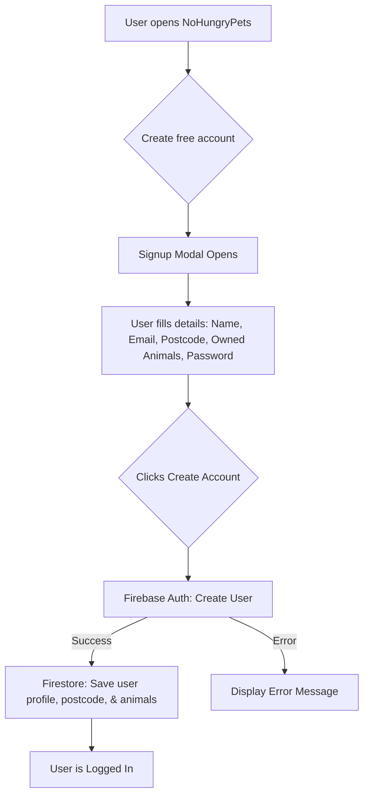

# NoHungryPets 🐾

**NoHungryPets** is a simple, free community website for sharing surplus pet food and supplies with people nearby — give what you can, take what you need.

- **Website**: `https://nohungrypets.co.uk`

## What’s in this repo

This repository hosts the **static frontend** (HTML/CSS/JS) for the NoHungryPets website.

## Setup Instructions

### Backend (Firebase)
To manage users and dynamic listings, this project is designed to integrate with Firebase:
1. Create a project in the [Firebase Console](https://console.firebase.google.com/).
2. Enable **Authentication** (Email/Password) to manage users.
3. Enable **Firestore Database** to store listings and user profiles.
4. Add your Firebase configuration keys to the `js/main.js` file (or a dedicated config file) using the Firebase Web SDK.

### Free Maps Integration
The map feature uses **Leaflet** combined with **OpenStreetMap** tile layers. 
- **No API keys are required.**
- It is completely free and open-source.
- The map initialization script is included at the bottom of the HTML files (e.g., `index.html` and `map.html`). 
- When generating real markers, fetch the coordinates from your Firestore database and plot them dynamically using Leaflet's `L.marker()` API.

### Image Hosting (Cloudinary)
To avoid the need for a credit card in Firebase, the platform uses **Cloudinary** for completely free image hosting (up to 25 GB).
- When a user posts a listing, the photos are automatically compressed on the client side using the HTML Canvas API.
- The photos are securely uploaded directly to Cloudinary using an **Unsigned Upload Preset**.
- The resulting image URLs are saved to the listing document in Firestore.

### Auto-Archiving
To keep the database clean, listings support an auto-archiving flow:
- When an item is taken, the owner marks it as **"Claimed"**.
- This applies a badge to the listing but leaves it visible for 24 hours.
- When the owner visits their Profile page, the app quietly checks all of their claimed listings in the background. If any have been claimed for more than 24 hours, the app auto-archives them to save space. (Note: Due to Cloudinary security limits, the images are kept in Cloudinary, but the tiny compressed files will take years to reach the 25 GB limit).

## Admin dashboard

An admin-only dashboard at `/admin`, gated by Firebase Auth. Who may see it is
decided by the `admins` collection — an account qualifies only if a document
exists at `admins/{their-uid}` (created in the Firebase Console, never from the
app), and `firestore.rules` enforces the same check server-side.

- **Community totals** — live counts of signups, active listings and items claimed.
- **Listings & activity** — last-7-day signups/listings/claims, archived count, "stale" (available 30+ days) count, and claim rate.
- **Recent signups** — the 10 newest members, emails masked by default.
- **Open reports** — listings members have flagged, resolvable inline (see Moderation).
- Links out to Firebase Analytics (GA4) and the Platform health dashboard.

## Moderation & reporting

- Signed-in members can **report a listing** from its detail view (reason + optional note).
- Reports are write-only for members and readable/resolvable only by admins (`reports` collection in `firestore.rules`); they appear in the admin "Open reports" table.
- Image uploads aren't auto-screened — reporting plus manual removal is the free moderation path.

## Account deletion (GDPR)

- Members can permanently delete their account from **Profile → Delete account**.
- After re-authentication it removes their listings and profile document, then the Firebase Auth account itself.
- Shared conversations and Cloudinary images are left for a periodic server-side cleanup, since deleting them would affect other members.

## Email verification & welcome email

- New email/password members are sent a **Firebase verification email** at signup — this doubles as the **welcome email** (its wording and sender are set in the Firebase Console email template, so no Resend or domain setup is needed; Firebase sends it).
- **Soft flow — nothing is blocked.** The signup toast asks them to check their inbox, and a dismissible "please verify your email" banner (with a **Resend** button, in `js/main.js`) shows site-wide to signed-in **unverified** password accounts. Google sign-ins are already verified, so they never see it.
- **Branding the email:** Firebase Console → Authentication → Templates → *Email address verification*. Firebase **locks the message body** (anti-spam), so you can only set the **Subject**, **Sender name** (use `NoHungryPets`), **From**, **Reply-to** and **Action URL**. The body's "Your `%APP_NAME%` team" line comes from **Project settings → General → Public-facing name**, so set that to `NoHungryPets`. For a fully custom-worded/branded welcome email, use a separate Resend job instead.
- **Optional — send from your own domain:** on that template, use *Customize domain* to send from `noreply@nohungrypets.co.uk` (add the TXT + CNAME records it shows at your DNS; a domain can have only one `v=spf1` record, so merge rather than add a second).

## Platform health dashboard

An admin-only status page at `/platform-health` — one view of the services the
site runs on, behind the same Firebase login as `/admin`.

- A scheduled GitHub Actions job (`.github/service-status/`, every 6h + manual) collects status **server-side** and writes a single `_meta/serviceStatus` doc to Firestore; the page just reads that doc, so no secret ever touches the public page.
- **GitHub Actions** tile — latest run of each workflow, failing count, open Dependabot alerts.
- **Resend** tile — emails sent today (/100) and this month (/3,000), plus last-send time.
- **Vendor status links** — GitHub, Resend, Cloudinary, Firebase, Google Cloud, OpenStreetMap, postcodes.io.
- **↻ Reload** re-reads the data instantly; **⟳ Refresh stats** opens the GitHub run page to trigger a fresh collect.
- Reuses the `FIREBASE_SA_KEY` secret; reads Resend with a dedicated full-access `RESEND_READ_API_KEY` (a send-only key can't list emails).

> **Note:** security-rule changes only take effect once `firestore.rules` is
> published — via the "Deploy Firestore Rules" workflow or a manual publish in
> the Firebase Console. If a new collection's rule isn't live, admin pages can't
> read it.

## Marketing Automation

A free, zero-billing-account pipeline drafts Facebook posts (and the
occasional illustration) for the NoHungryPets Page and emails them to
`info.nohungrypets@gmail.com` for manual review — nothing is auto-posted. It
runs as a scheduled GitHub Actions workflow (Mon/Wed/Fri) using Gemini for
text/image generation and Resend for delivery. See
[`marketing-agent/script/README.md`](marketing-agent/script/README.md) for
how it works and how to configure it.

## Message Notifications

Members get an **email when someone messages them**, so replies to a claim
don't sit unseen. Like the marketing pipeline, it's a **free, no-billing-account**
scheduled GitHub Actions workflow (every ~10 minutes) — no Firebase Blaze plan
or Cloud Functions required. See
[`.github/message-notifier/`](.github/message-notifier/) and
[`.github/workflows/message-notifier.yml`](.github/workflows/message-notifier.yml).

How it works: the job reads Firestore with a Firebase **service account**
(admin access, so no security-rules change is needed), finds conversations
updated since the last run that still have unread messages, and emails each
affected member a summary via **Resend**. A checkpoint in `_meta/messageNotifier`
ensures each message is emailed once, not on every run.

**Setup:** it reuses the marketing agent's existing secrets — `FIREBASE_SA_KEY`
and `RESEND_API_KEY` — so there are **no new secrets to add**. Test on demand
with **Actions → Message Notifier → Run workflow**.

> **Reaching all members:** on Resend's free tier the sandbox sender
> (`onboarding@resend.dev`) only delivers to your Resend signup address. To
> email every member, [verify `nohungrypets.co.uk` in Resend](https://resend.com/domains)
> and set a `FROM_EMAIL` repo **variable** (e.g. `notifications@nohungrypets.co.uk`).

## Automated PR Reviews

Every pull request is reviewed automatically by **Claude** (Haiku) via the
[`claude-review.yml`](.github/workflows/claude-review.yml) workflow — it runs the
`code-review` plugin and authenticates with a Claude subscription OAuth token
(`CLAUDE_CODE_OAUTH_TOKEN`), so there's no API billing. Complements the existing
[CodeQL](https://github.com/agapasieka/nohungrypets/security/code-scanning)
and [gitleaks](.github/workflows/gitleaks.yml) checks: Claude reviews
logic/style/simplification, CodeQL scans for vulnerability patterns, gitleaks
scans for accidentally committed secrets.

## Signup Flow Diagram

Here is a diagram illustrating the signup process and how it integrates with Firebase:

## License

See `LICENSE`.
